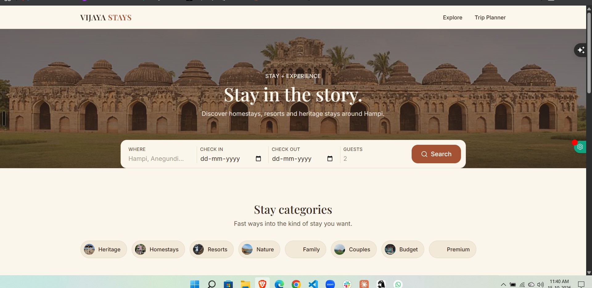
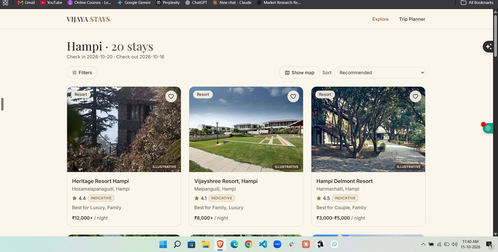
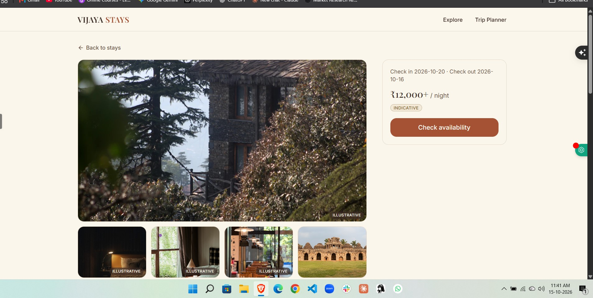
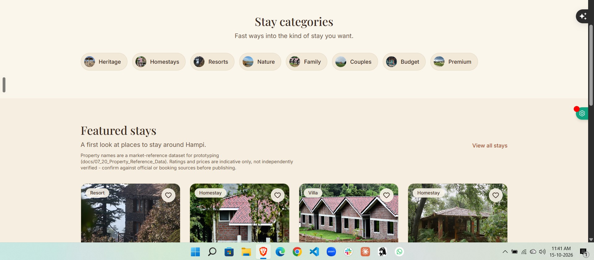
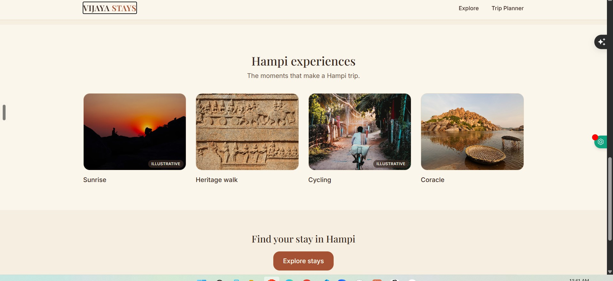

# Vijaya Stays — Accommodation Discovery Prototype

## Overview
Vijaya Stays is a product prototype created as part of a project assignment to improve accommodation discovery around Hampi.

## Problem
Travelers need a straightforward way to discover accommodation options and explore nearby attractions when planning a trip.

## Product Goal
Create a clear discovery experience that helps users browse stays, filter options and explore attractions.

## My Contribution
- Translated the assignment brief into product features and user-facing workflows.
- Built a frontend prototype using React and Vite.
- Implemented property discovery, search, filters and attraction discovery.
- Structured property and attraction data to support browsing.
- Developed reusable UI components to organize the experience.

## Product Decisions
- Organized information to make accommodation discovery easier.
- Included search and filters to support property exploration.
- Connected accommodation discovery with attraction discovery and trip planning.

## Technology
- React
- Vite
- Tailwind CSS
- JavaScript

## Current Status
Frontend prototype developed as an assignment. Commercial launch and user validation are not claimed.

## Future Improvements
- Conduct usability testing with prospective travelers.
- Measure search-to-property-view conversion.
- Evaluate whether users can find suitable stays efficiently.

## Project Links

- **Live Prototype:** https://vijaya-stays.vercel.app/
- **Source Code:** https://github.com/kiranskk2797/vijaya-stays

## Project Type

Frontend prototype developed as part of a project assignment.

## Current Status

Deployed prototype available for demonstration. User validation, commercial launch and business impact have not been established.

- Test the usefulness of attraction discovery and trip-planning features.

## Key Learning
This project provided practical experience translating an assignment brief into a frontend product prototype.

## Prototype Screenshots

### Homepage and Search

### Accommodation Listings

### Property Details

### Stay Categories

### Hampi Experiences

## Product Thinking and Trade-offs

### Target Users
- Travelers planning a visit to Hampi.
- Travelers comparing different accommodation categories.
- Visitors interested in combining stays with local experiences.

These are proposed user segments that require validation.

### Product Decisions

**1. Search-first homepage**
Placed destination and stay-date inputs prominently to give travelers a clear starting point.

**2. Category-based discovery**
Included categories such as heritage, homestays, resorts, budget and premium to support different discovery preferences.

**3. Scannable property cards**
Displayed property names, locations, indicative prices and ratings to help users compare options.

**4. Stay and experience discovery**
Included Hampi experiences alongside accommodation discovery to support broader trip planning.

### Trade-offs and Limitations
- The prototype prioritizes discovery over a complete booking transaction.
- Prices and ratings are indicative and require verification.
- No claims are made about validated user needs, conversion improvements or business outcomes.

### Proposed Success Metrics

| Metric | What it measures |
|---|---|
| Search-to-detail click-through rate | Whether listings attract user interest |
| Availability-check rate | Whether users progress toward booking |
| Filter usage rate | Whether users use filters to narrow choices |
| Task completion rate | Whether users can find suitable stays during usability testing |

These metrics are proposed for future testing; no production analytics are currently claimed.

## Live Prototype

[Explore Vijaya Stays](https://vijaya-stays.vercel.app/)

